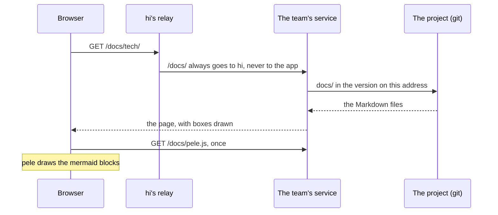

Every app a hi team builds has its docs on its own addresses, at `/docs`
on the preview and on production, such as `https://app.example.com/docs`.
The first thing you see is two ways in: **User docs** and **Tech docs**.
hi serves them itself, from the project's `docs/` folder in the version
on that address, so they work whatever the app is written in, and the
docs on production always match production's code.

## User docs

For the people who use the app, in plain words and the app's own names
for its pages and buttons. They live in `docs/user/`, a page per file:

- **Why it exists** and **who it's for**: the app's story, which only its
  owners can tell. While it is missing, the lead asks an owner for it
  and files it as a task, for the owner's agent to write in their
  words. The lead reads it before it answers what the app is for.
- **What's in it**: the app's major parts and what each does, with a page
  of its own for a part with more to say, such as `docs/user/orders.md`.
- **How to do things**: the common tasks, step by step.

The helper's **Ask** tab answers from these pages, and points people to
the page that says more. A project from before the user docs keeps
`HELP.md`, which is then its user docs.

## Tech docs

For developers, and for agents that need to trace how the app is built
and why. The menu holds:

- **The first page**, `docs/tech/index.md`: the parts of the app and how
  they connect, drawn. A `boxes` block is a structure diagram like the
  ones in this guide (boxes in boxes, numbered marks, a key), written as
  JSON; a `mermaid` block is a chart in [Mermaid](https://mermaid.js.org)'s
  language, such as a sequence for how a request flows or an `erDiagram`
  of the tables. More pages go in `docs/tech/`.
- **The map**, `docs/map.md`: what the project has and where each part
  lives.
- **The changelog**: hi writes it from the team's releases, each version
  with its date, notes, and the work it brought; on the preview, what dev
  has that production hasn't yet.
- **Decisions** (`docs/decisions/`), **Specs** (`docs/specs/`), and
  **Notes** (`docs/specs/notes/`), each a group of its own.

The dev box's instructions tell its agents to update the docs in the same
work as the change: the user docs for anything the people will see, the
tech docs when the parts or how they connect change, and the map.

## Charts

hi draws the `mermaid` blocks with [pele](https://pele.run), which reads
Mermaid's language and draws every kind of chart Mermaid has built in:
flowcharts, sequences, classes, states, `erDiagram`, Gantt, timelines,
git graphs, C4, pies, mind maps, kanban, quadrant, XY, sankey, radar,
treemap and more. It draws in the page's colors, light or dark, and turns
a wide flowchart on its side on a phone. hi serves pele itself, at
`/docs/pele.js`, so the charts load nothing from elsewhere. A chart with
a mistake shows its text and what is wrong, and the rest of the page
still draws.

This is how a page of the docs reaches you:

The app can use pele too, for charts on its own pages: your agent adds the
[`pele` package](https://www.npmjs.com/package/pele) and calls
`render(text)`, which gives an SVG, in the browser or on the server.

## For agents

`/llms.txt` on the app's address (and `/docs/llms.txt`) says what the app
is, lists every page with its file, and the app's MCP server when
`docs/user/mcp.md` tells of one. `/llms-full.txt` is all the user docs in
one file, and `/docs/raw/<file>` gives a file as it is, such as
`/docs/raw/docs/tech/index.md`. See [Apps agents can use](/guide/team/agents/).

## Who can read them

Whoever can open the app's address: the docs have its key, password, or
login. The helper's button is on the docs' pages too. Turning the helper
off doesn't take the docs away; `/docs/` belongs to hi, so the app can't
use it for a page of its own.
