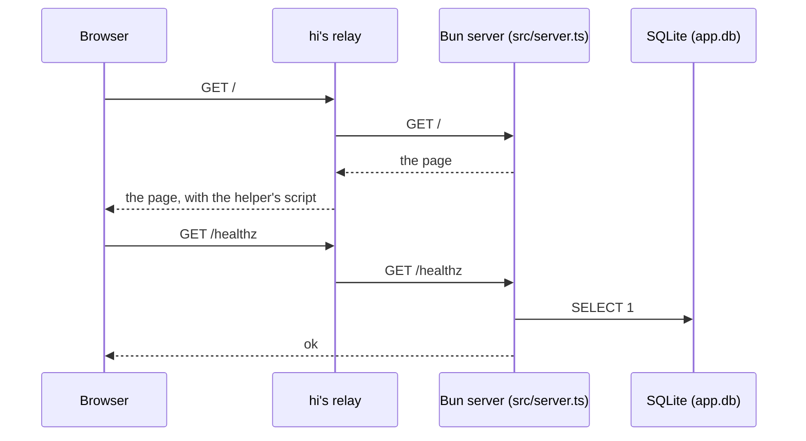

# How Hifin Template Name is built

<!-- The first page of the tech docs, at /docs/tech/ on the app's address,
for developers and agents: the parts of the app and how they connect,
drawn. A boxes block is a structure diagram like the hi guide's (boxes in
boxes, numbered marks, a key; docs/guide-diagrams.md in hi says how), and
a mermaid block a Mermaid chart: a sequence for how a request flows, an
erDiagram for the tables. Keep the detail in the map (docs/map.md), the
decisions (docs/decisions/), the specs (docs/specs/), and the code; hi
writes the changelog from the releases. Change this page in the same work
as a change to how the parts connect. -->

The app is a web app on Bun: one server for its pages and its API, with
its data in SQLite. hi runs it in a box on the team's machine and puts it
on the team's addresses, the preview (dev) and production.

## The parts

```boxes
{
  "caption": "How the app runs. People open the app's address in a browser. hi's relay, in front of every address the team has, adds the helper to each page and serves /docs/ itself; every other path goes to the app's box, where the Bun server in src/server.ts serves the pages and the API, and keeps the data in SQLite, app.db in $HI_DATA_DIR.",
  "you": "People using the app",
  "via": "the app's address",
  "frame": "the team's machine",
  "frame_mark": 1,
  "groups": [
    {
      "name": "relay", "label": "hi net expose", "mark": 2,
      "summary": "In front of every address the team has.",
      "items": [
        {"title": "/__hi/", "role": "the helper", "does": "The chat with the lead, help, and feedback, on every page.", "chip": "hi", "tone": "accent"},
        {"title": "/docs/", "role": "these docs", "does": "From `docs/` in the version on the address.", "chip": "hi", "tone": "accent"}
      ]
    },
    {
      "name": "app box", "label": "rootless container", "mark": 3, "via": "every other path",
      "summary": "The app, started with `make run`.",
      "items": [
        {"title": "src/server.ts", "role": "Bun server", "does": "The pages (React) and the API routes, on `$PORT`.", "chip": "Bun", "tone": "mint", "entry": "Pages and API"},
        {"title": "app.db", "role": "SQLite", "does": "In `$HI_DATA_DIR`, which outlives every release.", "chip": "SQLite", "tone": "dim"}
      ]
    }
  ],
  "key": [
    {"mark": 1, "term": "The team's machine", "text": "Where hi runs the team: its agents, its addresses, and a box for each version of the app."},
    {"mark": 2, "term": "The relay", "text": "hi's, not the app's: `/__hi/` and `/docs/` never reach the app."},
    {"mark": 3, "term": "The app's box", "text": "Holds one version of the app. Its data is in `$HI_DATA_DIR`, kept across releases."}
  ]
}
```

## How a request flows



## The data

No tables yet. When the first one lands, an `erDiagram` of the tables
goes here, from the migrations in `src/db.ts`.

## Read next

- [The map](../map.md): what the project has and where each part lives.
- The decisions, in `docs/decisions/`: why it is built as it is.
- The specs, in `docs/specs/`: what the lead and the people agreed,
  feature by feature.
- The changelog: what each release brought, written by hi.
